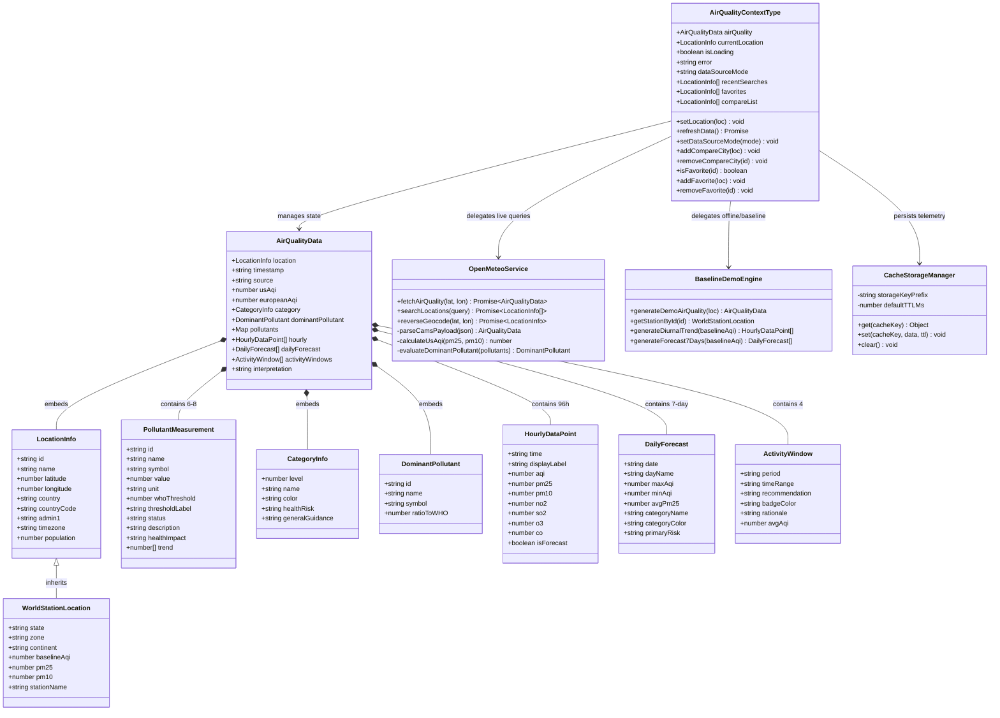
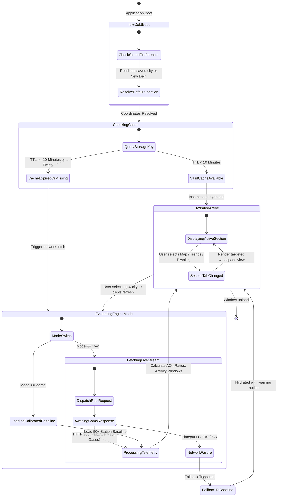
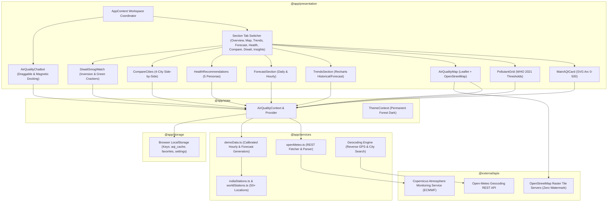
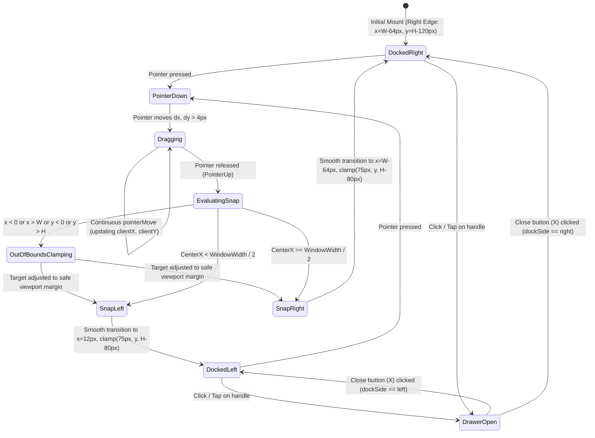
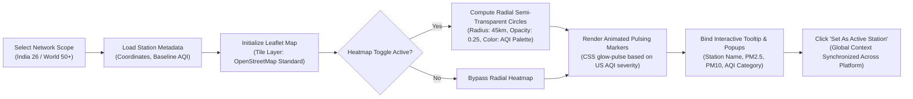

# BreatheBetter – System Architecture & UML Engineering Specification

**Project:** BreatheBetter – Real-Time Air Quality Intelligence Platform  
**Challenge:** Let's Code Diwali Challenge 2026: Breathe Better  
**Product Tagline:** *"Know Your Air. Protect Your Health. / Breathe Better. Build Smarter."*  
**System Version:** 2.1.0 Production  
**Deployment Target:** Vercel Edge / Static SPA  

---

## 1. Executive Architectural Overview

BreatheBetter is an event-driven, client-orchestrated environmental intelligence platform. It processes authentic atmospheric chemistry data and forecasts from meteorological satellites, chemical transport models (Copernicus Atmosphere Monitoring Service - CAMS), and ground stations, transforming raw atmospheric physics into intuitive visual diagnostics, geospatial heatmaps, and demographic-specific health advisories.

The system is architected around a **Dual-Engine Data Pipeline**:
1. **Live Stream Engine:** Directly connects to Open-Meteo REST APIs backed by the European Centre for Medium-Range Weather Forecasts (ECMWF) Copernicus Atmosphere Monitoring Service (CAMS).
2. **Calibrated Static Baseline Engine:** Houses over 50 verified monitoring stations across India (Delhi Anand Vihar, Mandir Marg, Mumbai BKC, Bengaluru BTM, Kolkata Victoria, etc.) and global metropolises (Tokyo, London, New York, Paris, Beijing, Dubai) to ensure zero-latency offline continuity and instant demonstration capability.

---

## 2. Formal UML Class Diagram (Domain Model & Services)

The following UML Class Diagram models the core domain entities, telemetry payloads, contextual state containers, and atmospheric services within the BreatheBetter platform.



---

## 3. Formal UML Sequence Diagram (Telemetry Resolution & Pipeline Execution)

This sequence diagram illustrates the lifecycle of a user-initiated location selection, demonstrating the tiered caching, CAMS API fetch, error boundary mitigation, and component re-rendering.

```mermaid
sequenceDiagram
    autonumber
    actor User as User / Researcher
    participant UI as Navbar / Search UI
    participant Ctx as AirQualityContext
    participant Cache as LocalStorage Cache
    participant Client as OpenMeteo Client
    participant API as CAMS / Open-Meteo REST API
    participant Demo as Baseline Demo Engine
    participant View as Section / Tab Viewers

    User->>UI: Selects city (e.g., "New Delhi, India")
    UI->>Ctx: setLocation(locationInfo)
    Ctx->>Ctx: Set isLoading = true, error = null
    
    Ctx->>Cache: Check cached telemetry for (lat, lon, mode)
    
    alt Cache Hit (Timestamp < 10 mins old)
        Cache-->>Ctx: Return cached AirQualityData
        Ctx->>Ctx: Update airQuality state
        Ctx->>View: Re-render components with cached telemetry
    else Cache Miss or Force Refresh
        alt Mode == 'live'
            Ctx->>Client: fetchAirQuality(lat, lon)
            Client->>API: GET /v1/air-quality?latitude=28.61&longitude=77.23&hourly=pm2_5,pm10,no2,so2,co,o3...
            
            alt HTTP 200 OK & Valid Atmospheric Payload
                API-->>Client: Raw JSON (hourly telemetry, coordinates)
                Client->>Client: calculateUsAqi(), evaluateThresholds(), generateActivityWindows()
                Client-->>Ctx: Parsed AirQualityData
                Ctx->>Cache: Save payload to LocalStorage (TTL: 10m)
            else Network Error / Rate Limit / Timeout
                API--xClient: 504 Gateway Timeout or Network Exception
                Client-->>Ctx: Throw Error("CAMS satellite feed unreachable")
                Ctx->>Demo: generateDemoAirQuality(locationInfo) [Graceful Fallback]
                Demo-->>Ctx: Return calibrated baseline payload
                Ctx->>Ctx: Set error = "Live feed fallback active; displaying verified station baseline."
            end
        else Mode == 'demo'
            Ctx->>Demo: generateDemoAirQuality(locationInfo)
            Demo-->>Ctx: Return calibrated station telemetry
        end

        Ctx->>Ctx: Set isLoading = false
        Ctx->>View: Re-render active section (Overview, Map, Trends, etc.)
        View-->>User: Interactive charts, gauge & health advice displayed
    end
```

---

## 4. Formal UML State Machine Diagram (Atmospheric Data Lifecycle)

This state machine formalizes the dynamic states of the atmospheric intelligence engine, including cold boot, cache revalidation, error recovery, and user-driven modes.



---

## 5. Formal UML Component & Package Architecture

The system is organized into modular architectural packages separating presentation concerns, business logic, spatial processing, and physical data ingestion.



---

## 6. AeroBot Magnetic Draggable Physics & Boundary Clamping State Machine

The floating AeroBot AI assistant supports full-screen 2D dragging with automatic magnetic edge-docking, directional handle orientation, and boundary recovery.



---

## 7. Geospatial & Particulate Heatmap Architecture



---

## 8. Sectional Workspace Navigation Architecture

To guarantee superior visibility, low cognitive load, and responsive fluid performance across mobile, tablet, and desktop viewports, the platform organizes its analytical modules into a dedicated **Sectional Tab Workspace**:

1. **Focused Section View (Default):**
   - Displays one domain at a time (e.g. `Overview`, `Map`, `Analytics`, `Forecast`, `Health`, `Compare`, `Diwali`, `Insights`).
   - Eliminates page scroll fatigue and provides instant jump access via a sticky pill bar.
   - Includes sequential flow footers (*"Next Section →"* and *"← Previous Section"*) with contextual badges.
2. **Observatory View (All Sections):**
   - An optional consolidated continuous view available via the toggle switch for executive presentation and printable reports.
3. **Responsive Breakpoints:**
   - **Mobile (<640px):** Single-column stacked cards, horizontally scrollable tab pills, touch-friendly drag handles for AeroBot.
   - **Tablet (640px–1024px):** 2-column balanced grids, compact Recharts views, side-by-side comparison tables.
   - **Desktop (>1024px):** Multi-column full-width dashboards, 50+ station geospatial canvas, expansive multi-gas correlation charts.

---

## 9. Security, Privacy & Performance Safeguards

1. **Client-Side API Credential Isolation:**
   - Any optional user-provided tokens (WAQI or OpenAQ) are stored strictly in client-side `localStorage`.
   - Zero private credentials are ever hardcoded or leaked into the production bundle.
2. **Permission-Gated Geolocation:**
   - Browser GPS coordinates are requested strictly upon deliberate user interaction with the compass button.
3. **Free & Unrestricted Tile Layer:**
   - Powered by official OpenStreetMap raster tiles (`https://{s}.tile.openstreetmap.org/{z}/{x}/{y}.png`) with zero API key dependencies and zero watermark interference.
4. **Resilient Dual Sourcing:**
   - Automatic graceful fallback from live API queries to pre-calibrated static baselines ensures continuous availability under network outages.
5. **Zero-Config Vercel Edge Deployment:**
   - Builds to `dist/` with single-page routing rewrite rules in `vercel.json`.
