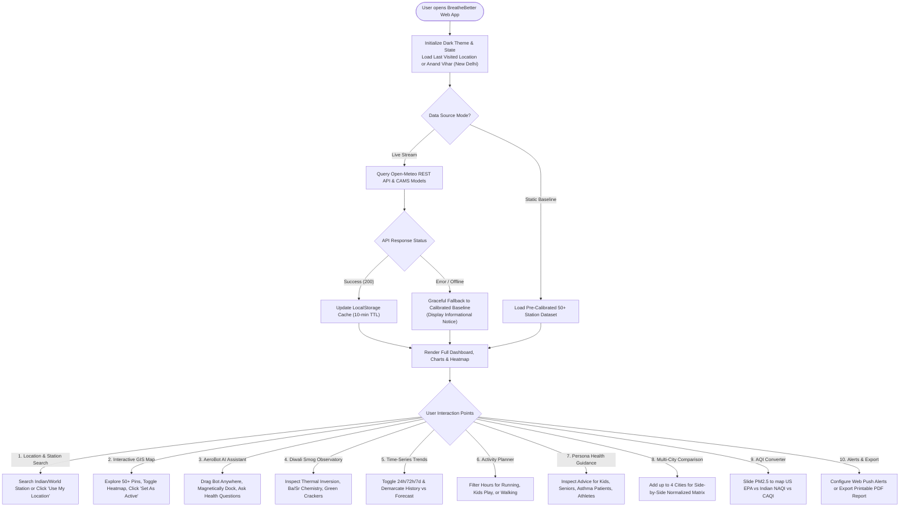
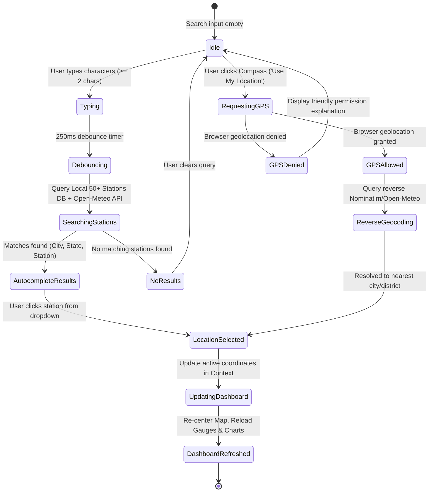
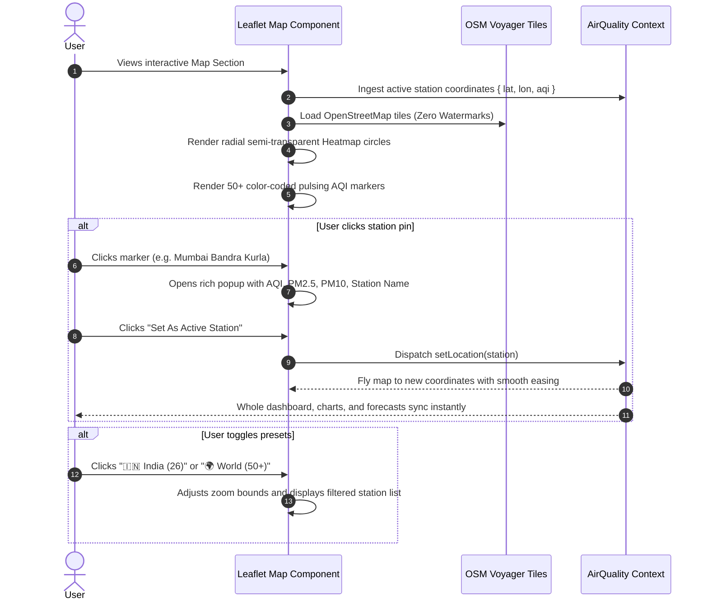
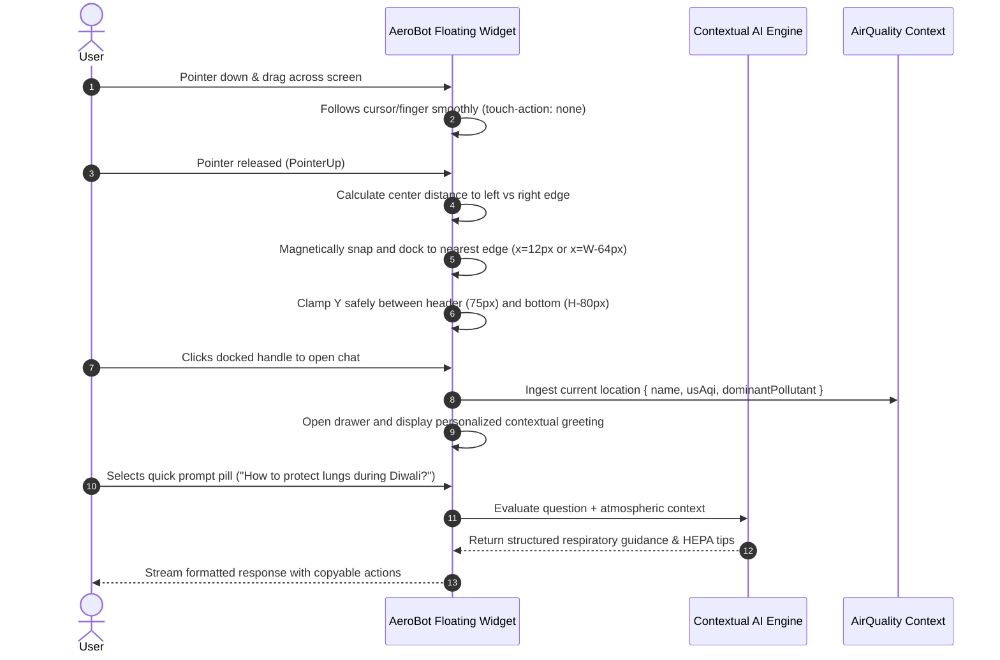
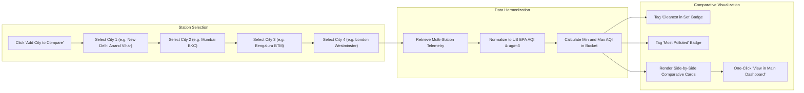
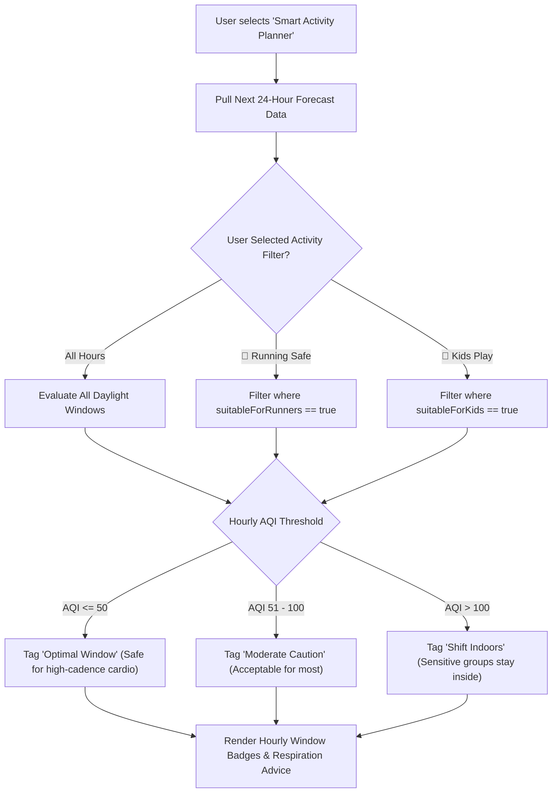
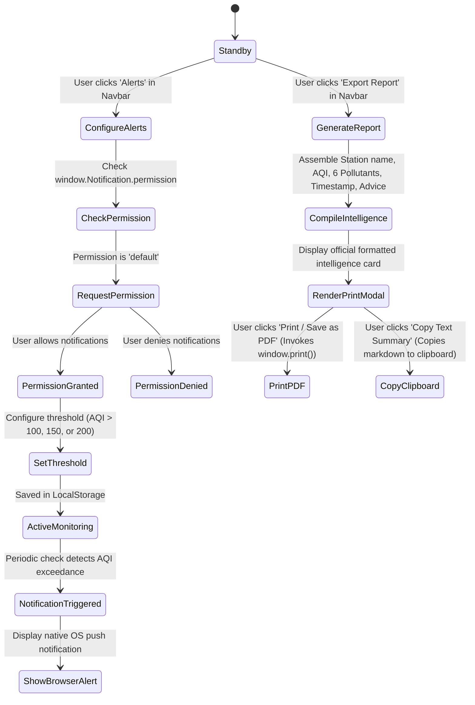
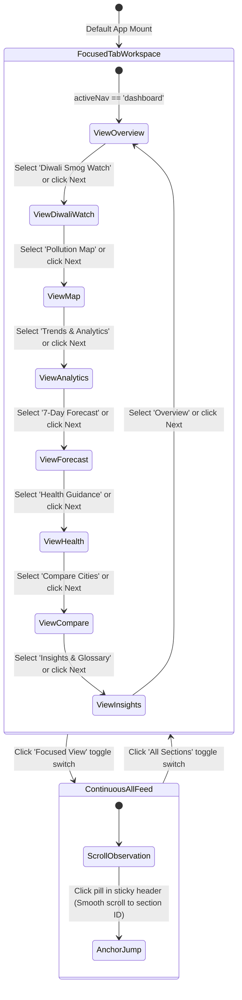

# BreatheBetter – Comprehensive Application & User Experience Flow

**Project:** BreatheBetter – Real-Time Air Quality Intelligence Platform  
**Challenge:** Let's Code Diwali Challenge 2026: Breathe Better  
**Document:** End-to-End User Experience, Interaction Workflows & State Machines  
**Version:** 2.0.0 Production  

---

## 1. High-Level User Journey Flowchart



---

## 2. Location Search & GPS Geolocation State Machine



---

## 3. Interactive Air Quality Map & Heatmap Flow



---

## 4. AeroBot AI Assistant Draggable & Magnetic Docking Flow



---

## 5. Multi-City Comparison Matrix Flow



---

## 6. Smart Outdoor Activity Planner Flow



---

## 7. Report Export & Web Alert Workflow



---

## 8. Sectional Workspace Navigation & Tour Flow



---

## 9. Responsive Breakpoint Layout Strategy

```
+-------------------------------------------------------------------------------+
| Breakpoint: Mobile (< 640px)                                                  |
| - Header: Compact Brand + Search Bar + Mobile Menu Drawer                     |
| - Jump Pills: Horizontally scrollable pill strip with touch momentum          |
| - Hero: Vertical stack (Main AQI Circular Gauge -> Rule Interpretation)       |
| - Pollutant Grid: Single column or 2-column compact grid                      |
| - Diwali Observatory: Collapsible tabs with touch-friendly cards              |
| - Map: Full width, height 450px, touch zoom enabled                           |
| - AeroBot: Floating draggable icon, magnetically docks to left/right edge     |
+-------------------------------------------------------------------------------+

+-------------------------------------------------------------------------------+
| Breakpoint: Tablet (640px - 1024px)                                           |
| - Header: Autocomplete Search + Indian Metro Strip                            |
| - Jump Pills: Visible horizontal sub-navigation                               |
| - Hero: Side-by-side gauge and interpretation card                            |
| - Pollutant Grid: 2 or 3 columns with 24h sparklines                          |
| - Map: Full width with floating legend and scope toggles                      |
| - Trends & Forecast: Multi-tab Recharts line & area views                     |
+-------------------------------------------------------------------------------+

+-------------------------------------------------------------------------------+
| Breakpoint: Desktop (>= 1024px)                                               |
| - Header: Full search, Metro strip, Converter, Alerts, Report, Settings       |
| - Hero: Full 12-column observatory layout with ambient status glow            |
| - Pollutant Grid: 6-card grid (PM2.5, PM10, NO2, SO2, CO, O3)                 |
| - Map: Interactive 50+ stations with radial heatmap density overlay           |
| - Compare Cities: 4-column side-by-side comparative matrix                    |
| - AeroBot: Fully draggable with magnetic edge docking anywhere on screen      |
+-------------------------------------------------------------------------------+
```
